<!-- ===================================================================== -->
<!-- 1. ANIMATED INTRODUCTION                                              -->
<!-- ===================================================================== -->

  <!-- Dynamic Futuristic Waving Hero Banner -->
  

  <!-- Animated Typing Tagline -->
  

   

  <!-- Live Status & Real Profile Visitor Counter -->
  

    
    
    
  

<!-- Custom Animated Pulse Divider -->

<!-- ===================================================================== -->
<!-- 2. ABOUT ME                                                           -->
<!-- ===================================================================== -->
##  `01 //` SYSTEM_IDENTITY : ABOUT ME

<table border="0" cellspacing="0" cellpadding="0" width="100%">
  <tr>
    <td width="58%" valign="middle">
      

        Hi, I'm <b>Prashant Kumar Ojha</b> — a <b>B.Tech Computer Science and Engineering</b> student driven by how modern software systems are built, deployed, automated, and scaled.
      

      

        I enjoy working across the entire engineering lifecycle: crafting responsive applications and backend APIs, structuring relational and vector databases, containerizing workloads, and connecting services through intelligent automation and data pipelines.
      

      <ul>
        <li>⚡ <b>Application Engineering:</b> Building full-stack applications and backend services with <b>Python, Java, React, Node.js, Express.js, and FastAPI</b>.</li>
        <li>☁️ <b>Cloud & Containers:</b> Packaging and deploying environments using <b>Docker, Docker Compose, Kubernetes, AWS EC2, and AWS S3</b>.</li>
        <li>🔄 <b>Data & Workflow Automation:</b> Designing automated workflows with <b>n8n</b> and exploring data pipelines using <b>Databricks and Amazon S3</b>.</li>
        <li>🧠 <b>Applied AI Systems:</b> Experimenting with <b>LLMs, Retrieval-Augmented Generation (RAG)</b>, and semantic search via <b>pgvector</b> and vector databases.</li>
      </ul>
    </td>
    <td width="42%" align="center" valign="middle">
      <!-- Custom Animated SVG Terminal (Rendered from local repo assets) -->
      
    </td>
  </tr>
</table>

<!-- ===================================================================== -->
<!-- 3. TECH STACK                                                         -->
<!-- ===================================================================== -->
##  `02 //` ARCHITECTURE_MATRIX : TECH STACK

  
<i>Technologies, tools, and architectures I actively build with, explore, and learn:</i>

<table width="100%">
  <thead>
    <tr>
      <th width="28%" align="left">Domain</th>
      <th width="72%" align="left">Technologies & Tools</th>
    </tr>
  </thead>
  <tbody>
    <!-- Programming -->
    <tr>
      <td><b>💻 Programming</b></td>
      <td>
        
        
      </td>
    </tr>
    <!-- Development -->
    <tr>
      <td><b>🌐 Development</b></td>
      <td>
        
        
        
        
      </td>
    </tr>
    <!-- Databases -->
    <tr>
      <td><b>🗄️ Databases</b></td>
      <td>
        
        
        
        
      </td>
    </tr>
    <!-- DevOps & Containers -->
    <tr>
      <td><b>🐳 DevOps & Containers</b></td>
      <td>
        
        
        
      </td>
    </tr>
    <!-- Cloud -->
    <tr>
      <td><b>☁️ Cloud Infrastructure</b></td>
      <td>
        
        
      </td>
    </tr>
    <!-- Data Engineering -->
    <tr>
      <td><b>📊 Data Engineering</b></td>
      <td>
        
        
      </td>
    </tr>
    <!-- Automation -->
    <tr>
      <td><b>⚡ Workflow Automation</b></td>
      <td>
        
      </td>
    </tr>
    <!-- AI -->
    <tr>
      <td><b>🧠 Artificial Intelligence</b></td>
      <td>
        
        
        
      </td>
    </tr>
    <!-- Developer Tools -->
    <tr>
      <td><b>🛠️ Developer Tools</b></td>
      <td>
        
        
      </td>
    </tr>
  </tbody>
</table>

 

<!-- Animated Skill Icons Dock -->

  

<!-- ===================================================================== -->
<!-- 4. FEATURED PROJECTS                                                  -->
<!-- ===================================================================== -->
##  `03 //` DEPLOYED_MODULES : FEATURED PROJECTS

> **Note:** Replace `[YOUR_REPO_NAME_1]` through `[YOUR_REPO_NAME_4]` below with your exact public repository names on `github.com/upgradojha` to automatically generate live repository cards.

<table width="100%" border="0" cellspacing="0" cellpadding="8">
  <tr>
    <!-- Project Slot 1: AI / RAG / Vector DB -->
    <td width="50%" valign="top">
      <h3 align="center">🧠 [PLACEHOLDER: AI & RAG Application]</h3>
      

        
      

      

        <b>Overview:</b> <i>[Replace with 1–2 sentences describing your LLM/RAG project, e.g., Semantic document search and Q&A pipeline powered by FastAPI, PostgreSQL, and pgvector.]</i>
      

      

        
        
        
        
      

    </td>
    <!-- Project Slot 2: Data Engineering / Cloud Pipelines -->
    <td width="50%" valign="top">
      <h3 align="center">📊 [PLACEHOLDER: Data Pipeline & Cloud Project]</h3>
      

        
      

      

        <b>Overview:</b> <i>[Replace with 1–2 sentences describing your data engineering project, e.g., Automated data ingestion and transformation pipeline utilizing Databricks and Amazon S3.]</i>
      

      

        
        
        
        
      

    </td>
  </tr>
  <tr>
    <!-- Project Slot 3: Full-Stack & Containerized Architecture -->
    <td width="50%" valign="top">
      <h3 align="center">🌐 [PLACEHOLDER: Full-Stack / DevOps Project]</h3>
      

        
      

      

        <b>Overview:</b> <i>[Replace with 1–2 sentences describing your web/DevOps project, e.g., Full-stack web application built with React, Node.js, and Express, containerized with Docker Compose on AWS EC2.]</i>
      

      

        
        
        
        
      

    </td>
    <!-- Project Slot 4: Workflow Automation / Backend -->
    <td width="50%" valign="top">
      <h3 align="center">⚡ [PLACEHOLDER: Workflow Automation System]</h3>
      

        
      

      

        <b>Overview:</b> <i>[Replace with 1–2 sentences describing your automation or backend project, e.g., Multi-step event-driven workflow automation integrating n8n, REST APIs, and MongoDB.]</i>
      

      

        
        
        
      

    </td>
  </tr>
</table>

<!-- ===================================================================== -->
<!-- 5. GITHUB STATISTICS                                                  -->
<!-- ===================================================================== -->
##  `04 //` TELEMETRY_METRICS : GITHUB STATISTICS

  <!-- GitHub Stats & Top Languages Side-by-Side (Using reliable VNbergeron/Vercel mirror & fallback-safe layout) -->
  <table border="0" cellspacing="0" cellpadding="4">
    <tr>
      <td width="52%" align="center" valign="middle">
        
      </td>
      <td width="48%" align="center" valign="middle">
        
      </td>
    </tr>
  </table>

   

  <!-- Real-Time Contribution Graph -->
  

<!-- ===================================================================== -->
<!-- 6. LET'S CONNECT                                                      -->
<!-- ===================================================================== -->
##  `05 //` NETWORK_INTERFACE : LET'S CONNECT

  

    <i>Open to collaborating on full-stack applications, cloud-native deployments, workflow automation, and AI engineering projects.</i>
  

  <!-- Social & Contact Action Buttons -->
  

    
    <!-- Replace [YOUR_LINKEDIN_USERNAME] with your actual LinkedIn handle -->
    
    <!-- Replace [YOUR_EMAIL] with your public contact email -->
    
  

   
  <code>⚡ Crafted by Prashant Kumar Ojha • Systems Online</code>

<!-- Animated Footer Wave -->
